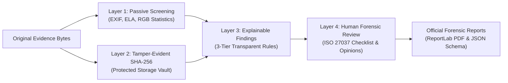

# SCSS SATYA — Forensic Image Authenticity Screening Platform

[](https://www.python.org/)
[](https://fastapi.tiangolo.com/)
[](https://react.dev/)
[](https://tailwindcss.com/)
[](tests/)
[](docs/METHODOLOGY.md)

**Full Title:** SCSS SATYA — Forensic Image Authenticity Screening Platform  
**Developed for:** Sure Clue Scientific Solutions (SCSS)  
**Challenge:** SEVA FIRST Innovation Challenge 2026  
**Sector:** Sector 9 — Emerging Technologies (AI, Blockchain and Others)  
**Sub-theme:** Sub-theme 4 — Responsible AI, Deepfake Detection, Cyber Resilience and Digital Trust  

---

## Institutional Guiding Doctrine

> ### **"The tool screens. The expert decides."**
> SCSS SATYA is an institutional-grade digital forensic screening and documentation platform. It analyzes digital images for potential manipulation indicators, extracts container metadata, computes JPEG recompression residuals, calculates cryptographic hashes, and generates explainable technical findings.  
> **The platform never produces arbitrary authenticity percentages (e.g., "99% fake"). It acts strictly as an objective technical aid for authorized human examiners.**

---

## 1. System Architecture: The Four-Layer Forensic Pipeline

SCSS SATYA operates across four scientifically bounded forensic layers:



### Layer 1 — Passive, Non-Invasive Image Screening
- **Pristine Ingestion:** Evaluates file magic bytes independently of user filenames. Enforces a 50 MB file size limit and 100 Megapixel decompression bomb limit.
- **EXIF / IPTC / TIFF Inspection:** Extracts camera make, model, timestamps, software signatures, optical exposure parameters, and GPS coordinates. Fields are classified into `Present`, `Missing`, `Unreadable`, or `Unsupported`. Missing metadata is honestly noted as standard for transmitted media and not evidence of manipulation.
- **Error Level Analysis (ELA):** Re-compresses JPEG working copies at Quality=90, computes pixel difference residuals, amplifies by 15×, and generates both high-contrast grayscale exhibits and false-color thermal Inferno heatmaps. Lossless formats (PNG, TIFF) honestly reject ELA as inapplicable.
- **Radiometric & Spatial Statistics:** Computes full-frame 32-bin RGB histograms, channel dynamic ranges, Laplacian spatial focus variance, and high-frequency noise residual sigma.

### Layer 2 — Tamper-Evident Evidence Integrity Record
- **Pristine Byte Hashing:** SHA-256 digests are calculated directly from raw network bytes prior to any decoding or transformation.
- **Vault Preservation:** Bytes are written to an isolated filesystem vault under non-overwriting UUID paths.
- **Integrity Verification:** A dedicated verification endpoint re-reads the vault-stored bytes directly from disk, re-hashes them, and verifies byte consistency against the recorded ingestion reference.
- **Tamper Detection:** Modifying even a single bit in the stored file immediately triggers a critical `MISMATCH` alert.

### Layer 3 — Explainable Technical Findings Engine
- **Three-Tier Status Model:** Every finding strictly adheres to:
  1. `No Indicator Detected` (nominal photographic baseline)
  2. `Indicator Observed` (empirical anomaly, software signature, or residual divergence)
  3. `Inconclusive` (missing metadata or unsupported format)
- **Zero Black-Box Scores:** Eliminates unsupported probability scores. Findings detail observed measurements, technical explanations, forensic significance, known limitations, and recommended human actions.

### Layer 4 — Qualified Human Forensic Review
- **ISO/IEC 27037 Context:** Mandatory manual verification checklist covering acquisition context, RAW camera master availability, metadata provenance, and chain-of-custody.
- **Examiner Credentials:** Captures examiner qualifications and tracks credential verification status (`UNVERIFIED` in prototype).
- **Formal Opinion Recording:** Requires explicit confirmation disclosure acknowledging that opinions are formulated by human practitioners, not generated by software.

---

## 2. Technology Stack

### Frontend
- **Framework:** React 19 + TypeScript
- **Build Tool:** Vite 6
- **Styling:** Tailwind CSS v4 (Custom Navy `#0F1E36`, Gold `#C5A059`, Light & Dark themes)
- **Data Visualization:** Recharts (Interactive 32-bin RGB radiometric histograms)
- **Icons:** Lucide React
- **Routing:** React Router v7

### Backend
- **Language:** Python 3.11
- **API Framework:** FastAPI + Pydantic v2
- **Image Processing:** Pillow + OpenCV headless (`opencv-python-headless`) + NumPy
- **Metadata Parser:** ExifRead + PIL ExifTags
- **Database:** SQLite + SQLAlchemy ORM (Timezone-aware UTC timestamps)
- **Report Engine:** ReportLab (Two-pass NumberedCanvas for accurate "Page X of Y" PDF generation)
- **Testing:** pytest + FastAPI TestClient

---

## 3. Visual Design System

| Element | Color Code | Purpose |
| :--- | :--- | :--- |
| **Primary Navy** | `#0F1E36` | Main branding, primary buttons, headers |
| **Secondary Navy** | `#172B47` | Navigation elements, active cards |
| **Refined Gold** | `#C5A059` | Accent highlights, doctrine callouts, borders |
| **Light Background** | `#F4F6F9` | Clean laboratory workspace background |
| **Dark Background** | `#0A1220` | Full dark theme workspace background |
| **Surface (Light/Dark)**| `#FFFFFF` / `#111C2E` | Card surfaces, modal containers |
| **Positive / Nominal**| `#0D9488` / `#10B981` | Muted teal/green for nominal findings |
| **Attention Required**| `#D97706` | Restrained amber for observed indicators |
| **Integrity Mismatch** | `#EF4444` | Accessible red for cryptographic hash failures |

---

## 4. Quick Start & Execution Guide

### Prerequisites
- Python 3.11+
- Node.js v20+ and npm

### Option A: One-Click Startup (Windows)
From the project root, run either:
```cmd
npm run dev
```
or:
```cmd
run.bat
```
This starts the unified application, including the Python backend. The launcher checks the Python virtual environment, builds frontend assets when needed, and launches the server.

### Option B: Manual Setup

#### 1. Backend Setup
```bash
cd backend
python -m venv .venv

# Windows:
.venv\Scripts\activate
# Linux/macOS:
# source .venv/bin/activate

pip install -r requirements.txt
```

#### 2. Frontend Build
```bash
cd frontend
npm install
npm run build
cd ..
```

#### 3. Run Automated Tests
```bash
cd backend
python -m pytest tests/ -v
```

#### 4. Launch Unified Application
```bash
python scripts/run_backend.py
```

To run only the frontend development server with Vite hot reload, use this from the project root:
```bash
npm run dev:frontend
```
The backend must be started separately for API requests.

### Application URLs
- **Web Dashboard:** [http://127.0.0.1:8000/](http://127.0.0.1:8000/)
- **Interactive API Documentation (Swagger):** [http://127.0.0.1:8000/docs](http://127.0.0.1:8000/docs)
- **ReDoc Technical Reference:** [http://127.0.0.1:8000/redoc](http://127.0.0.1:8000/redoc)
- **Health Check Endpoint:** [http://127.0.0.1:8000/api/health](http://127.0.0.1:8000/api/health)

---

## 5. One-Click Calibrated Test Specimens

The platform provides three reproducible synthetic specimens to demonstrate and calibrate the screening layers:

- **Specimen A (Camera-Style Photograph):** Synthetic natural landscape rendered with gradient shading, simulated Gaussian noise, and embedded synthetic camera EXIF tags. Demonstrates nominal ELA residuals.
- **Specimen B (Spliced Composite):** Base image compressed at Q=75 with an inserted high-contrast badge and embedded `GIMP 2.10` software tag. Demonstrates divergent recompression residuals and software signature observation.
- **Specimen C (Lossless Calibration PNG):** True 24-bit PNG calibration target. Demonstrates clean ingestion, SHA-256 hashing, RGB statistics, and explicit rejection of JPEG ELA.

Demonstration specimens can be generated directly via the UI or using:
```bash
python scripts/create_sample_images.py
```

---

## 6. Official Forensic Reporting

Official reports are generated on demand from stored examination records:
- **PDF Report (ReportLab):** Navy and gold institutional design, two-pass accurate page numbering ("Page X of Y"), embedded ELA heatmap exhibit, metadata breakdown, explainable findings table, examiner credentials, checklist status, examiner opinion, and statutory signature lines.
- **JSON Report:** Machine-readable report structured under schema version `1.0.0` containing complete serialized records of evidence, cryptographic hashes, findings, and disclaimers.

---

## 7. Legal & Statutory Disclaimers

### ISO/IEC 27037:2012
Conforms to ISO/IEC 27037:2012 guidelines regarding non-destructive digital evidence handling and SHA-256 verification.

### Indian Statutory Framework: Section 63 BSA, 2023
In Indian legal proceedings, electronic records are governed by **Section 63 of the Bharatiya Sakshya Adhiniyam, 2023 (BSA)** (superseding former Section 65B of the Indian Evidence Act, 1872). Software reports generated by SCSS SATYA provide supporting technical screening documentation but do not replace an official Section 63 certificate signed by the person in lawful control of the electronic device.

---

## 8. License & Institutional Attribution

Developed for **Sure Clue Scientific Solutions (SCSS)** for the **SEVA FIRST Innovation Challenge 2026** (Sector 9, Sub-theme 4).  
*All rights reserved. Digital Forensic Screening Prototype.*
