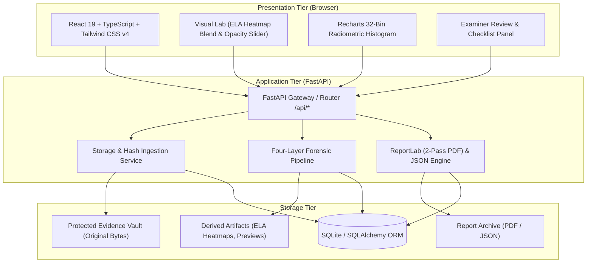

# SCSS SATYA — Architecture & System Design

**Full Project Title:** SCSS SATYA — Forensic Image Authenticity Screening Platform  
**Developed for:** Sure Clue Scientific Solutions (SCSS)  
**Challenge:** SEVA FIRST Innovation Challenge 2026 (Sector 9, Sub-theme 4)  
**Guiding Doctrine:** *"The tool screens. The expert decides."*

---

## 1. High-Level Architectural Overview

SCSS SATYA is structured around a decoupled, service-oriented architecture designed to ensure cryptographic evidence preservation, reproducible technical observations, explainable findings, and qualified human forensic oversight.



---

## 2. Directory Structure

```
scss-satya/
├── backend/
│   ├── app/
│   │   ├── main.py                 # FastAPI application & SPA fallback server
│   │   ├── api/                    # API endpoints
│   │   │   ├── health.py           # /api/health, /api/system/info, /api/system/metrics
│   │   │   ├── cases.py            # /api/cases CRUD & reference generation
│   │   │   ├── evidence.py         # /api/evidence/*, /api/evidence/{id}/verify
│   │   │   ├── examinations.py     # /api/examinations (Ingestion & screening)
│   │   │   ├── analysis.py         # /api/examinations/{id}/ela & statistics
│   │   │   ├── reviews.py          # /api/examinations/{id}/review
│   │   │   ├── reports.py          # /api/reports/* (PDF & JSON exports)
│   │   │   └── specimens.py        # /api/specimens/* (One-click test targets)
│   │   ├── core/                   # System configuration, constants, security
│   │   ├── database/               # SQLAlchemy models & SQLite session
│   │   ├── schemas/                # Pydantic v2 validation contracts
│   │   ├── services/               # Cryptographic storage & audit services
│   │   ├── analysis/               # ELA, EXIF metadata, spatial statistics, findings
│   │   └── reports/                # ReportLab 2-pass PDF & JSON builders
│   ├── tests/                      # Automated test suite (pytest)
│   └── requirements.txt
├── frontend/
│   ├── src/
│   │   ├── components/             # Reusable UI, exhibits, findings, modals
│   │   ├── context/                # ThemeContext (Light / Dark mode)
│   │   ├── layouts/                # MainLayout, Sidebar, TopHeader
│   │   ├── pages/                  # Dashboard, NewExam, Detail, Vault, Methodology, System
│   │   ├── services/               # Typed API client
│   │   └── types/                  # TypeScript data models
│   ├── dist/                       # Production SPA build output
│   └── package.json
├── storage/
│   ├── vault/                      # Pristine original evidence bytes
│   ├── artifacts/                  # ELA heatmaps and visual exhibits
│   ├── reports/                    # Generated PDF & JSON forensic reports
│   ├── specimens/                  # Synthesized demonstration files
│   └── database/                   # SQLite database (satya.db)
├── docs/                           # Scientific, security, and legal documentation
├── scripts/
│   ├── run_backend.py              # Unified production-style server launcher
│   └── create_sample_images.py     # Specimen generation script
├── run.bat                         # Windows one-click execution script
└── README.md
```

---

## 3. Four-Layer Forensic Workflow Pipeline

The core operational workflow transitions through four scientifically bounded layers:

### Layer 1: Passive, Non-Invasive Image Screening
- **Evidence Ingestion:** Evaluates magic bytes independently of file extensions; enforces a 50 MB byte limit and 100 Megapixel decompression limit (preventing decompression bombs).
- **EXIF / IPTC / TIFF Inspection:** Parses device provenance, timestamps, software signatures, optical parameters, and GPS tags. Evaluates fields into `Present`, `Missing`, `Unreadable`, or `Unsupported`.
- **Error Level Analysis (ELA):** Applied strictly to JPEG images by re-encoding a memory copy at Quality=90, calculating absolute error residuals, amplifying by 15×, and rendering false-color Inferno heatmaps. Lossless formats (PNG, TIFF) honestly reject ELA as scientifically inapplicable.
- **Radiometric & Spatial Noise Statistics:** Measures 32-bin RGB histograms, channel means/std deviations, Laplacian edge variance, and high-frequency noise residual sigma.

### Layer 2: Tamper-Evident Evidence Integrity Record
- **Ingestion SHA-256 Digest:** Calculated strictly from raw ingested file bytes prior to decoding or scaling.
- **Isolated Vault Storage:** Bytes written to storage vault with randomized UUIDs; files are never modified or overwritten.
- **Integrity Verification Endpoint:** Re-reads stored bytes from disk, computes SHA-256, compares against ingestion reference, and outputs `VERIFIED` or `MISMATCH`.

### Layer 3: Explainable Technical Findings Engine
- **Three-Tier Status Model:** Every finding strictly adheres to `No Indicator Detected`, `Indicator Observed`, or `Inconclusive`.
- **Zero Hallucination / No Arbitrary Scores:** No arbitrary percentage probabilities (e.g., "99% fake"). Every finding reports observed measurements, technical explanation, forensic significance, known limitations, and recommended human actions.

### Layer 4: Qualified Human Forensic Review
- **Expert Review Dossier:** Captures examiner name, organization, qualification, and credential verification status (`UNVERIFIED` in prototype).
- **ISO/IEC 27037 Checklist:** Manual checklist covering RAW file availability, metadata consistency, and device chain of custody.
- **Examiner Opinion:** Supports recording formal opinion with explicit statutory disclosure confirmation.
